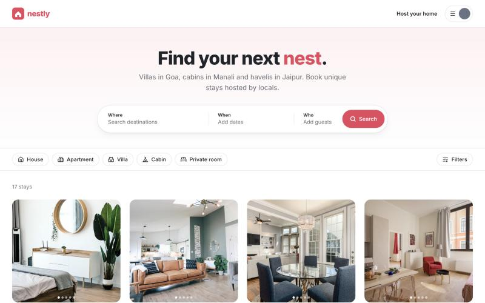
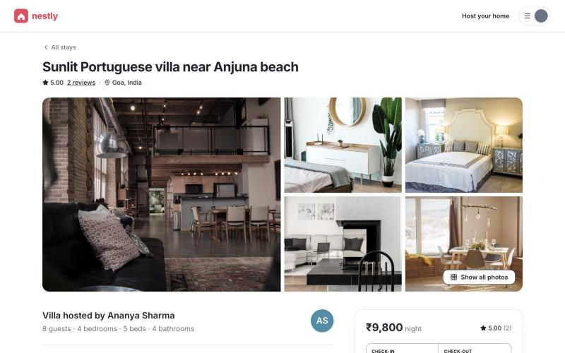
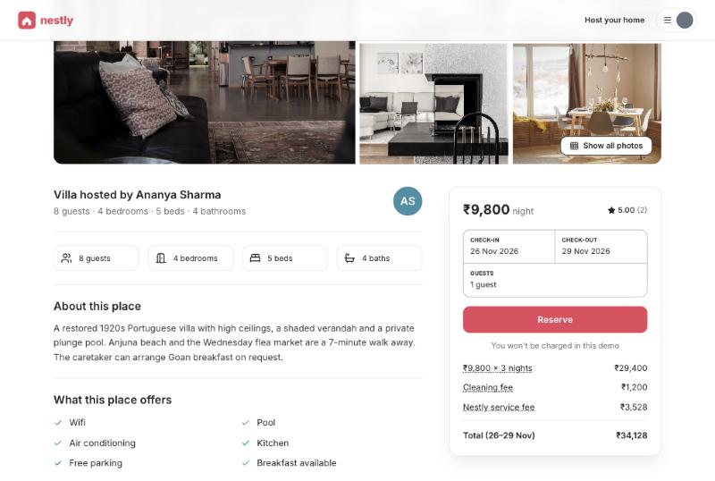
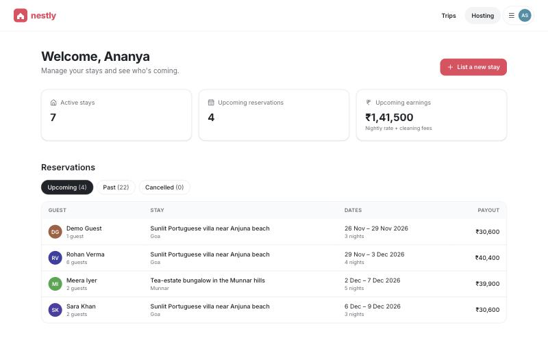

# Nestly: a full-stack vacation-rental booking app

Nestly is an Airbnb-style marketplace for unique stays across India. Guests search by destination, dates and party size, book stays and review them afterwards. Hosts list properties and track their reservations and earnings.

It's built from scratch with **React + TypeScript** on the front end and **Node.js, Express, Prisma and PostgreSQL** on the back end. Availability and double-booking rules are enforced in the database itself.



| Listing page | Booking with live price breakdown | Host dashboard |
|:--:|:--:|:--:|
|  |  |  |

---

## Features

**For guests**
- Search by destination (with autocomplete), check-in/check-out dates and number of guests. Stays that are booked on your dates are filtered out.
- Filter by property type and price, and sort by price, newest or most reviewed.
- Listing pages with a photo gallery, amenities, host details and reviews.
- An availability calendar that strikes through booked nights and won't let a selection cross one. You can check out on the day the next guest checks in.
- A live price breakdown (nights × rate, cleaning fee, 12% service fee). The server recalculates the price and its number is the one charged.
- **My trips**: upcoming, past and cancelled stays. Cancel an upcoming trip, or leave a 1–5★ review after checking out.

**For hosts**
- Create, edit and delete listings with validated forms and photo previews.
- A dashboard with active stays, upcoming reservations, upcoming earnings, and every reservation by status.
- A listing with upcoming bookings can't be deleted.

**Engineering**
- **No double bookings, even under concurrent requests.** A PostgreSQL `EXCLUDE USING gist` constraint on `daterange(checkIn, checkOut)` rejects overlapping confirmed bookings at the database level. The API's own check gives a friendly early error, and if two requests still race past it, Postgres rejects one and the API returns `409`. A test fires 5 simultaneous bookings and asserts exactly one succeeds.
- Logins use an `httpOnly`, `SameSite=Lax` cookie holding a signed JWT, so page scripts can't read the token. Passwords are hashed with bcrypt.
- Every input is validated with **zod**, and field-level error messages are shown next to the right form fields.
- Dates are stored as Postgres `DATE` values and passed around as `YYYY-MM-DD` strings, so a stay never shifts by a day across time zones.
- **26 API tests** (Vitest + Supertest) against a real PostgreSQL test database.
- In production one Express server serves the API and the built React app, so the whole project deploys as a single service.

## Tech stack

| Layer | Tools |
|---|---|
| Frontend | React 19, TypeScript, Vite, Tailwind CSS v4, React Router 7, TanStack Query, react-day-picker, date-fns, lucide-react |
| Backend | Node.js, Express 5, TypeScript, Prisma ORM, zod, JSON Web Tokens, bcrypt, helmet |
| Database | PostgreSQL (`btree_gist` exclusion and `CHECK` constraints) |
| Testing | Vitest, Supertest |
| Deployment | Dockerfile + docker-compose |

## Architecture

```
client/  (React SPA)                    server/  (Express API)                  PostgreSQL
  pages/  Home, Listing, Trips,   ──►   /api/auth      register, login, me ──►  User
          Host, ListingForm,      fetch /api/listings  search, CRUD             Listing
          Login/Signup            +     /api/bookings  book, cancel, review     Booking ◄─ no-overlap
  lib/api.ts  typed API client    cookie /api/host     dashboard data          Review     constraint
```

<details>
<summary><b>API reference</b></summary>

| Method | Path | Auth | Description |
|---|---|:--:|---|
| `POST` | `/api/auth/register` | | Create an account and log in |
| `POST` | `/api/auth/login` | | Log in |
| `POST` | `/api/auth/logout` | | Log out |
| `GET` | `/api/auth/me` | | Current user, or `null` |
| `GET` | `/api/listings` | | Search: `city`, `checkIn`, `checkOut`, `guests`, `minPrice`, `maxPrice`, `types`, `sort`, `page` |
| `GET` | `/api/listings/destinations` | | Cities with stay counts, for autocomplete |
| `GET` | `/api/listings/:id` | | Listing with host, reviews and booked date ranges |
| `POST` | `/api/listings` | ✓ | Create a listing |
| `PATCH` | `/api/listings/:id` | host | Update a listing |
| `DELETE` | `/api/listings/:id` | host | Delete (blocked if there are upcoming bookings) |
| `POST` | `/api/bookings` | ✓ | Book a stay |
| `GET` | `/api/bookings/mine` | ✓ | My trips |
| `POST` | `/api/bookings/:id/cancel` | guest | Cancel an upcoming trip |
| `POST` | `/api/bookings/:id/review` | guest | Review a finished stay |
| `GET` | `/api/host/listings` | ✓ | My listings with booking counts |
| `GET` | `/api/host/reservations` | ✓ | Reservations on my listings |

</details>

## Run it locally

**You'll need:** Node.js 20+ and PostgreSQL 14+.

1. Install dependencies:
   ```bash
   npm install
   ```
2. Create the databases:
   ```bash
   createdb nestly_dev && createdb nestly_test
   ```
3. Configure the server:
   ```bash
   cp server/.env.example server/.env
   ```
   Then edit `DATABASE_URL` in `server/.env` to point at `nestly_dev`.
4. Create the tables and load the demo data:
   ```bash
   npm run db:setup
   ```
5. Start the API (port 4000) and the web app (port 5173):
   ```bash
   npm run dev
   ```

Open http://localhost:5173. Two demo accounts are set up, both with the password `password123`:

- `guest@nestly.dev` has an upcoming trip and a past stay ready to review.
- `host@nestly.dev` owns 6 stays with reservations.

The login page also has buttons that fill these in.

### Tests

```bash
npm test
```

The tests run against `nestly_test`, never your dev data. To use a different database, set `TEST_DATABASE_URL`.

### Production build

```bash
npm run build
NODE_ENV=production JWT_SECRET=<32+ random chars> npm start
```

This serves the app and API together on port 4000. With Docker, `docker compose up --build` starts PostgreSQL and the app together.

## Project structure

```
├── client/                 React app
│   └── src/
│       ├── pages/          Home, ListingPage, Trips, Host, ListingForm, Auth
│       ├── components/     Layout, SearchBar, ListingCard, pickers, ui
│       └── lib/            api client, auth context, formatting
├── server/                 Express API
│   ├── prisma/             schema, migrations (incl. constraints), seed data
│   ├── src/
│   │   ├── routes/         auth, listings, bookings, host
│   │   ├── middleware/     auth cookie, validation and error handling
│   │   └── lib/            dates, pricing, HTTP errors
│   └── tests/              API tests
├── Dockerfile
└── docker-compose.yml
```

## Possible next steps

- Payments with Stripe Checkout (test mode)
- Photo uploads to object storage instead of image links
- A map view of search results
- Messaging between guests and hosts

---

Built by [Aman Kumar](https://github.com/aman01k). Listing photos are from [Unsplash](https://unsplash.com).
